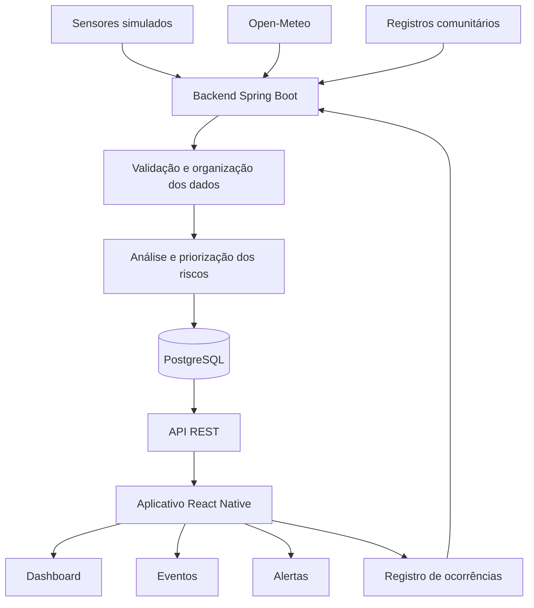

<div align="center">

[](https://github.com/ArthurEdersonSilva?tab=repositories)
[](https://github.com/ArthurEdersonSilva?tab=repositories)
[](https://github.com/ArthurEdersonSilva?tab=repositories)

# 🌆 Urban Risk Intelligence Platform

## FIAP Global Solution 2026

### Plataforma Integrada de Monitoramento e Análise de Riscos Urbanos

**Monitoramento inteligente | Análise de risco | Alertas prioritários | Participação comunitária**

</div>

---

## 📄 Apresentação do projeto

A **Urban Risk Intelligence Platform** é uma plataforma desenvolvida para a **Global Solution da FIAP**, com o objetivo de monitorar, organizar e analisar informações relacionadas a riscos cotidianos em ambientes urbanos.

O sistema contempla três categorias principais de ocorrências:

- **Alagamentos:** monitoramento de níveis de água e identificação de condições potencialmente críticas.
- **Ilhas de calor:** acompanhamento de temperaturas elevadas e identificação de situações de risco térmico.
- **Interrupções de serviços essenciais:** registro e acompanhamento de ocorrências que possam afetar a população.

A solução integra um **backend em Java com Spring Boot**, um **banco de dados PostgreSQL** e um **aplicativo desenvolvido em React Native**.

O backend recebe dados de sensores simulados, informações meteorológicas públicas e registros comunitários, processando essas informações por meio de regras analíticas de classificação de risco.

O aplicativo disponibiliza um painel de acompanhamento, listagem de eventos, notificações visuais de alertas prioritários e uma interface para registro de ocorrências.

**O projeto possui finalidade acadêmica e utiliza sensores simulados, sem necessidade de equipamentos físicos.**

---

<div align="center">

## 🛠️ Tecnologias Utilizadas


</div>

---

## 🎯 Objetivos

A plataforma foi projetada para:

1. Centralizar informações relacionadas a riscos urbanos.
2. Integrar dados de sensores simulados, fontes públicas e registros comunitários.
3. Persistir os dados coletados em banco relacional.
4. Identificar situações que demandam atenção prioritária.
5. Aplicar análise quantitativa à classificação de alertas.
6. Disponibilizar informações por meio de uma API REST.
7. Apresentar informações em um aplicativo mobile.
8. Permitir o registro comunitário de ocorrências.
9. Manter a interface responsiva diante de falhas temporárias de comunicação.
10. Apoiar a visualização e o acompanhamento de situações de risco.

---

## 🏗️ Arquitetura da solução

A aplicação utiliza uma arquitetura modular composta por três camadas principais:

| Camada | Tecnologia | Responsabilidade |
|:---|:---|:---|
| Backend | Java 17 e Spring Boot | Regras de negócio, processamento e API REST |
| Persistência | PostgreSQL 16 | Armazenamento de sensores, eventos, alertas e dados climáticos |
| Frontend | React Native, Expo e TypeScript | Interface de monitoramento e interação do usuário |

### Fluxo de dados



O backend centraliza o processamento das informações e disponibiliza os dados para o aplicativo por meio de requisições HTTP.

---

## ⚙️ Backend — Spring Boot

O backend foi desenvolvido em **Java 17 com Spring Boot 3**, seguindo uma arquitetura organizada em camadas.

### Controllers

Responsáveis por receber requisições HTTP e expor os endpoints da API.

- `SensorController.java`
- `EventoController.java`
- `AlertaController.java`
- `DadosPublicosController.java`

### Services

Responsáveis pelas regras de negócio e pelo processamento das informações.

- `SensorService.java`
- `EventoService.java`
- `AlertaService.java`
- `ColetaClimaticaService.java`

### Repositories

Responsáveis pelo acesso e persistência dos dados utilizando Spring Data JPA.

- `SensorRepository.java`
- `EventoRepository.java`
- `AlertaRepository.java`
- `DadoClimaticoRepository.java`

### Entidades

Representam os dados utilizados pela aplicação.

- `Sensor.java`
- `Evento.java`
- `Alerta.java`
- `DadoClimatico.java`

---

## 🌡️ Monitoramento por sensores simulados

A plataforma permite trabalhar com leituras simuladas de sensores urbanos.

A utilização de sensores simulados permite demonstrar o funcionamento das regras de monitoramento sem depender de dispositivos físicos.

### Temperatura

| Temperatura | Interpretação |
|:---|:---|
| Abaixo de 35 °C | Condição normal |
| De 35 °C a menos de 40 °C | Atenção |
| 40 °C ou mais | Risco alto |

### Nível de água

| Nível de água | Interpretação |
|:---|:---|
| Abaixo de 50 cm | Condição normal |
| De 50 cm a menos de 80 cm | Atenção |
| 80 cm ou mais | Risco alto |

Esses limites são **parâmetros experimentais do protótipo**, utilizados para demonstrar o funcionamento da classificação de riscos.

Não representam limites oficiais de defesa civil.

---

## 🌦️ Integração com dados meteorológicos públicos

A plataforma utiliza a **Open-Meteo** como fonte externa de informações meteorológicas.

A integração permite consultar:

- Temperatura do ar.
- Precipitação.
- Data e horário da leitura.
- Coordenadas geográficas.
- Identificação da fonte dos dados.

A implementação utiliza como referência geográfica a cidade de **São Paulo — SP**.

### Coleta automatizada

O serviço `ColetaClimaticaService` realiza consultas periódicas à fonte pública.

A coleta é configurada para ocorrer aproximadamente a cada **15 minutos**, enquanto o backend estiver em execução.

As informações recebidas são armazenadas no PostgreSQL, permitindo consultas posteriores ao histórico climático.

O sistema também verifica o horário da leitura para reutilizar registros correspondentes, reduzindo duplicações.

### Endpoints meteorológicos

| Método | Endpoint | Finalidade |
|:---|:---|:---|
| GET | `/api/dados-publicos/clima` | Consultar dados meteorológicos da fonte pública |
| POST | `/api/dados-publicos/clima/atualizar` | Consultar e persistir uma leitura |
| GET | `/api/dados-publicos/clima/historico` | Consultar o histórico armazenado |

Fonte: [Open-Meteo](https://open-meteo.com/)

---

## 🧠 Motor analítico de priorização de alertas

O sistema utiliza um **modelo analítico baseado em pontuação ponderada** para apoiar a classificação e priorização de alertas.

A análise considera quatro fatores:

| Fator | Peso |
|:---|---:|
| Severidade da ocorrência | 40% |
| Nível de confiança | 30% |
| População afetada | 20% |
| Recência da ocorrência | 10% |
| **Total** | **100%** |

### Fórmula conceitual

O cálculo combina os fatores normalizados:

```text
Pontuação de risco =
    0,40 × Severidade
  + 0,30 × Confiança
  + 0,20 × População afetada
  + 0,10 × Recência
```

A pontuação resultante é utilizada para estabelecer uma ordem de prioridade.

### Classificação

| Pontuação | Prioridade |
|:---|:---|
| Inferior a 40 | BAIXA |
| De 40 a menos de 70 | MEDIA |
| 70 ou mais | ALTA |

A classificação permite que ocorrências de maior criticidade recebam destaque no sistema.

**Abordagem adotada:** análise quantitativa baseada em regras, sem treinamento de modelos de machine learning.

Os parâmetros são experimentais e têm finalidade acadêmica.

---

## 📍 Origem e confiança das informações

Os sensores, eventos e alertas possuem campos para identificação da origem e do nível de confiança.

As fontes utilizadas incluem:

| Origem | Descrição |
|:---|:---|
| Sensores simulados | Leituras geradas para representar condições urbanas |
| Open-Meteo | Informações meteorológicas obtidas de API pública |
| Comunidade | Ocorrências registradas pelos usuários do aplicativo |

O nível de confiança é utilizado como informação auxiliar no processo analítico.

Os dados climáticos persistidos possuem identificação da fonte, enquanto a atribuição de uma pontuação numérica própria de confiança para essas leituras permanece uma possibilidade de evolução do protótipo.

---

## 📱 Aplicativo React Native

O aplicativo foi desenvolvido utilizando **React Native, Expo e TypeScript**.

A interface organiza as informações em telas específicas, facilitando o acompanhamento das condições urbanas.

### Dashboard

O painel principal apresenta:

- Quantidade de sensores ativos.
- Quantidade de eventos ativos.
- Quantidade de alertas ativos.
- Situação da conexão com o backend.
- Horário da última sincronização.
- Monitoramento individual dos sensores.
- Indicação visual dos níveis de risco.
- Seção de monitoramento climático.

### Eventos

A tela de eventos permite:

- Consultar ocorrências registradas.
- Identificar o status dos eventos.
- Pesquisar informações.
- Filtrar ocorrências.
- Visualizar informações associadas aos registros.

### Alertas

A tela de alertas permite:

- Consultar alertas disponíveis.
- Identificar o nível de prioridade.
- Visualizar informações relacionadas ao risco.
- Acompanhar a situação dos alertas.

Alertas ativos de prioridade alta também podem ser destacados visualmente no Dashboard.

### Registro comunitário

O aplicativo permite registrar ocorrências com informações como:

- Título.
- Categoria de risco.
- Descrição.
- Endereço e referência.
- Localização geográfica.

O cadastro pode utilizar a geolocalização do dispositivo, mediante permissão do usuário.

---

## 🔄 Atualização e disponibilidade

O Dashboard realiza consultas periódicas à API para atualizar as informações apresentadas.

### Atualização dos dados

- Sensores, eventos e alertas: atualização configurada a cada **10 segundos**.
- Histórico climático no aplicativo: consulta periódica independente.
- Coleta meteorológica no backend: aproximadamente a cada **15 minutos**.

Esses intervalos representam configurações do sistema e não medições de latência efetiva.

### Tratamento de desconexões

A interface foi estruturada para lidar com falhas temporárias de comunicação.

Quando a API deixa de responder:

1. O aplicativo identifica a falha de conexão.
2. A interface informa que o backend está desconectado.
3. Os últimos dados disponíveis podem permanecer visíveis.
4. Novas tentativas de conexão são realizadas automaticamente.
5. Após a recuperação do serviço, os dados voltam a ser consultados.

Esse comportamento permite demonstrar a continuidade da interface mesmo diante da indisponibilidade temporária do backend.

---

## 🔌 API REST — Principais endpoints

### Sensores

| Método | Endpoint | Descrição |
|:---|:---|:---|
| GET | `/api/sensores` | Listar sensores |
| GET | `/api/sensores/{id}` | Consultar sensor por ID |
| PATCH | `/api/sensores/{id}/leitura` | Atualizar leitura simulada |

### Eventos

| Método | Endpoint | Descrição |
|:---|:---|:---|
| GET | `/api/eventos` | Listar eventos |
| GET | `/api/eventos/{id}` | Consultar evento |
| POST | `/api/eventos` | Registrar ocorrência |
| PATCH | `/api/eventos/{id}/status` | Atualizar status |

### Alertas

| Método | Endpoint | Descrição |
|:---|:---|:---|
| GET | `/api/alertas` | Listar alertas priorizados |

### Dados públicos

| Método | Endpoint | Descrição |
|:---|:---|:---|
| GET | `/api/dados-publicos/clima` | Consultar clima atual |
| POST | `/api/dados-publicos/clima/atualizar` | Persistir leitura meteorológica |
| GET | `/api/dados-publicos/clima/historico` | Consultar histórico meteorológico |

### Monitoramento da aplicação

```http
GET /actuator/health
```

Esse endpoint permite verificar o estado de funcionamento da aplicação.

---

## 🗄️ Persistência de dados

O sistema utiliza **PostgreSQL 16**, executado por meio de Docker Compose.

As principais entidades persistidas são:

| Entidade | Informações |
|:---|:---|
| Sensor | Tipo, localização, leitura, unidade, origem e confiança |
| Evento | Categoria, descrição, localização, severidade, origem e status |
| Alerta | Evento associado, prioridade, pontuação de risco e status |
| Dado climático | Temperatura, precipitação, fonte e datas das leituras |

O Spring Data JPA realiza o mapeamento entre as entidades Java e as tabelas do banco.

O Docker Compose utiliza um volume persistente para os dados do PostgreSQL.

---

## 📂 Estrutura do projeto

```text
Urban-Risk-Intelligence/
│
├── backend/
│   ├── pom.xml
│   └── src/
│       ├── main/
│       │   ├── java/com/urbanrisk/
│       │   │   ├── UrbanRiskApplication.java
│       │   │   ├── controller/
│       │   │   ├── model/
│       │   │   ├── repository/
│       │   │   └── service/
│       │   └── resources/
│       │       └── application.properties
│       └── test/
│           └── java/com/urbanrisk/
│               └── AlertaServiceTest.java
│
├── mobile/
│   ├── App.tsx
│   ├── index.js
│   ├── app.json
│   ├── package.json
│   ├── package-lock.json
│   ├── tsconfig.json
│   └── src/
│       ├── components/
│       │   ├── NotificacaoAlerta.tsx
│       │   └── PainelClimatico.tsx
│       ├── screens/
│       │   ├── DashboardScreen.tsx
│       │   ├── EventosScreen.tsx
│       │   ├── AlertasScreen.tsx
│       │   └── CadastroOcorrenciaScreen.tsx
│       └── services/
│           └── api.ts
│
├── docker-compose.yml
├── .gitignore
└── README.md
```

---

## ⚙️ Como executar

### Pré-requisitos

Para executar o projeto, são necessários:

- Java JDK 17.
- Apache Maven.
- Node.js e npm.
- Docker Desktop com Docker Compose.
- Git.
- Navegador web ou dispositivo compatível com Expo.

### 1. Clonar o repositório

```bash
git clone https://github.com/ArthurEdersonSilva/Urban-Risk-Intelligence.git
cd Urban-Risk-Intelligence
```

### 2. Iniciar o PostgreSQL

Na raiz do projeto, execute:

```bash
docker compose up -d
```

Verifique o serviço:

```bash
docker compose ps
```

O banco PostgreSQL utiliza a porta `5432`.

A configuração local padrão é:

```text
Banco: urbanrisk
Usuário: postgres
Senha de desenvolvimento: postgres
Porta: 5432
```

A senha pode ser alterada por meio da variável de ambiente `DB_PASSWORD`.

A configuração padrão é destinada exclusivamente ao desenvolvimento local.

### 3. Iniciar o backend

Abra um terminal na pasta `backend`:

```bash
cd backend
```

Execute os testes e compile:

```bash
mvn clean package
```

Inicie a aplicação:

```bash
mvn spring-boot:run
```

Alternativamente, após compilar, é possível executar:

```bash
java -jar target/urban-risk-backend-1.0.0.jar
```

O backend estará disponível em:

```text
http://localhost:8080
```

Para verificar o funcionamento:

```text
http://localhost:8080/actuator/health
```

Para consultar os sensores:

```text
http://localhost:8080/api/sensores
```

### 4. Configurar o endereço da API no aplicativo

Abra o arquivo:

```text
mobile/src/services/api.ts
```

Localize a configuração:

```typescript
const API_URL = "http://192.168.0.30:8080/api";
```

O endereço `192.168.0.30` corresponde ao IP utilizado no ambiente de desenvolvimento original.

**Esse endereço deve ser substituído pelo IP local do computador que executa o backend.**

Para consultar o IP no Windows:

```powershell
ipconfig
```

Utilize o endereço IPv4 da interface de rede correspondente.

O computador e o celular devem estar na mesma rede para a comunicação local.

### 5. Iniciar o aplicativo

Abra outro terminal e acesse:

```bash
cd mobile
```

Instale as dependências:

```bash
npm install
```

Inicie o Expo:

```bash
npx expo start --port 8082
```

Para abrir a versão web:

```text
http://localhost:8082
```

Para executar no celular, utilize o Expo Go conforme a compatibilidade da versão instalada.

A disponibilidade das funcionalidades depende da comunicação entre o dispositivo e o backend.

---

## 🧪 Testes automatizados

O backend possui testes automatizados com JUnit, incluindo verificações da lógica de priorização de alertas.

Arquivo principal:

```text
backend/src/test/java/com/urbanrisk/AlertaServiceTest.java
```

Para executar os testes:

```bash
cd backend
mvn test
```

Critérios esperados:

- Compilação sem erros.
- Execução das verificações automatizadas.
- Ausência de testes com falha.
- Resultado `BUILD SUCCESS`.

---

## 📊 Indicadores de avaliação

A plataforma prevê a avaliação de três indicadores exigidos na Global Solution.

| Indicador | Método de avaliação |
|:---|:---|
| Tempo de atualização | Medir o intervalo entre a atualização de uma leitura e sua exibição no aplicativo |
| Qualidade dos alertas | Verificar se os cenários simulados recebem a prioridade esperada |
| Facilidade de uso | Avaliar a conclusão de tarefas no aplicativo |

### Tempo de atualização

A avaliação considera a atualização de um dado simulado no backend e sua posterior apresentação no Dashboard.

A frequência de consulta configurada é de 10 segundos, mas o tempo efetivo depende da execução, da rede e do processamento.

### Qualidade dos alertas

A avaliação utiliza cenários simulados para verificar a coerência das classificações.

São considerados casos com condições normais, níveis intermediários e situações críticas.

### Facilidade de uso

A avaliação pode considerar tarefas como:

- Localizar um evento.
- Consultar um alerta.
- Registrar uma ocorrência.
- Identificar o status de conexão.

Os resultados quantitativos devem ser registrados após a execução dos testes.

---

## 🛡️ Disponibilidade, escalabilidade e proteção de dados

### Disponibilidade

A aplicação utiliza consultas periódicas e tratamento de falhas para permitir a recuperação da comunicação após interrupções temporárias.

### Escalabilidade

A separação entre frontend, backend e persistência permite evoluções independentes dos componentes.

O uso de Spring Boot, API REST e PostgreSQL constitui uma base modular para expansão futura.

O protótipo não implementa balanceamento de carga, alta disponibilidade distribuída ou escalabilidade automática.

### Proteção de dados

O aplicativo solicita permissão para acessar a localização do dispositivo quando essa funcionalidade é utilizada.

Os registros comunitários podem conter coordenadas e informações de localização, devendo ser tratados com atenção à privacidade.

O projeto é um protótipo acadêmico e não deve ser utilizado com informações pessoais sensíveis em ambientes públicos sem controles adicionais de segurança.

---

## 🎬 Demonstração da Global Solution

A apresentação pode seguir a seguinte sequência:

1. Iniciar o PostgreSQL no Docker.
2. Executar o backend Spring Boot.
3. Demonstrar os endpoints da API REST.
4. Abrir o aplicativo React Native.
5. Exibir sensores, eventos e alertas.
6. Atualizar uma leitura simulada e observar o Dashboard.
7. Demonstrar a priorização dos alertas.
8. Registrar uma ocorrência comunitária.
9. Parar o backend.
10. Demonstrar o aviso de desconexão no aplicativo.
11. Reiniciar o backend.
12. Demonstrar a recuperação automática da comunicação.

Essa demonstração permite apresentar a integração entre as stacks e o comportamento da interface diante de falhas temporárias.

---

## ⚠️ Limitações

- O sistema possui finalidade acadêmica e experimental.
- Os sensores utilizados são simulados.
- Os limites de risco foram definidos para demonstração.
- Os dados meteorológicos dependem da disponibilidade da Open-Meteo.
- O backend precisa permanecer em execução para realizar a coleta automática.
- O banco PostgreSQL é executado localmente.
- O aplicativo depende de acesso à API na rede configurada.
- As notificações implementadas são visuais dentro da aplicação.
- A classificação de riscos utiliza regras analíticas e não substitui avaliações de órgãos competentes.
- A solução não deve ser utilizada como sistema oficial de resposta a emergências.

---

## 🚀 Possibilidades de evolução

Entre as possíveis melhorias futuras estão:

- Integração com novas bases públicas.
- Ampliação da cobertura geográfica.
- Implementação de mapas interativos.
- Notificações push.
- Autenticação e controle de acesso.
- Análise histórica de tendências urbanas.
- Modelos preditivos de risco.
- Implantação em infraestrutura de nuvem.
- Monitoramento de múltiplas regiões.

Essas funcionalidades não fazem parte do escopo obrigatório do protótipo atual.

---

<div align="center">

## 👥 Desenvolvedores

### FIAP — Global Solution 2026

**Arthur Ederson de Oliveira Silva**

Engenharia de Computação — FIAP

**RM: 557079**

[](https://github.com/ArthurEdersonSilva)
[](https://www.linkedin.com/in/arthurederson/)

<br>

**Lucas do Carmo Cima**

Engenharia de Computação — FIAP

**RM: 564964**

---

### Urban Risk Intelligence Platform

**FIAP Global Solution 2026**

Protótipo acadêmico de monitoramento e análise de riscos urbanos.

</div>
